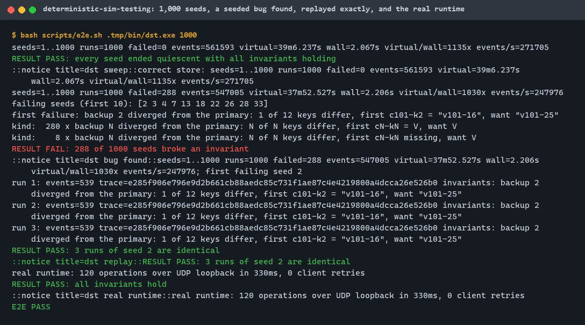
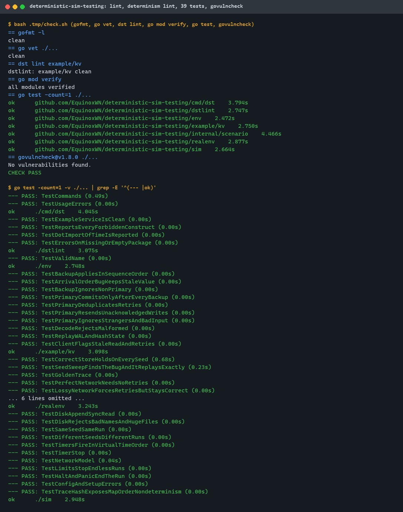
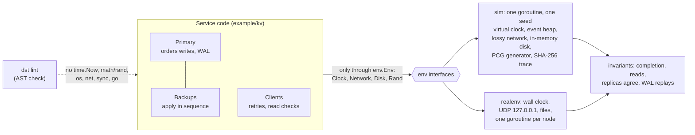
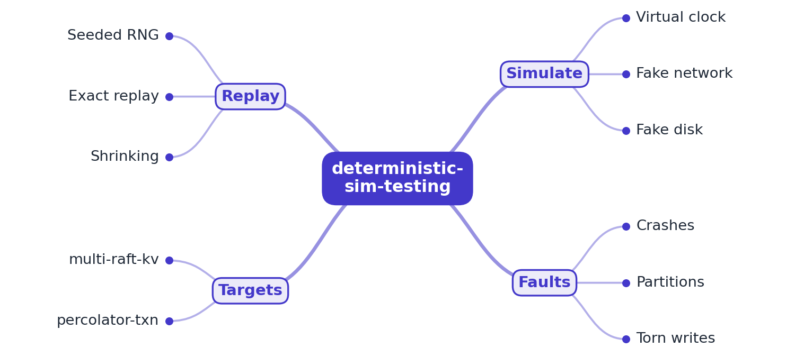

# deterministic-sim-testing

[](https://github.com/EquinoxWN/deterministic-sim-testing/actions/workflows/ci.yml)


> The rare production bug you can never reproduce, caught: run a whole distributed system in a simulation where any failure replays exactly.

Part of my **Distributed Systems & Storage** list · Go

> Planned targets (M3): multi-raft-kv and percolator-txn, from the same portfolio.

## Proof it works

A primary-backup key-value store runs in the simulator under message loss, duplication and random
latency. Over 1,000 seeds the correct store never breaks an invariant. With a deliberate
replication bug (backups apply writes in arrival order), 288 of the same 1,000 seeds fail, the
first failing seed replays three times to the identical trace hash and failure, and the unchanged
nodes also pass on the real runtime (UDP loopback, wall clock, real files):



39 tests pass, the determinism lint finds nothing in the example service, and govulncheck finds no
vulnerabilities:



## Architecture

**What M1 runs today:**



**Full roadmap (M1 to M3):**



## How it works

_Steps 1 and 2 are built and tested (M1); the rest is on the [roadmap](#roadmap)._

1. Services depend only on interfaces for time, network, disk and randomness, which the framework swaps for simulated versions.
2. One seeded random generator drives all scheduling and faults, so the same seed always produces the same run.
3. The virtual clock jumps ahead, simulating hours of cluster time in seconds.
4. Crashes, partitions, torn writes and clock skew are injected according to the seed.
5. When an invariant fails, the seed is saved; the run replays exactly and is shrunk to a minimal failing case.
6. It tests multi-raft-kv and percolator-txn, and the README lists the real bugs it found.

In M1 a service is a set of event handlers (`Start`, `Receive`, timer callbacks) written against
`env.Env`. The simulator runs every handler of every node on one goroutine, ordered by virtual
time and a tie-breaker drawn from the seeded generator. The network model draws drops,
duplicates and a latency per message from the same generator, and every value a node draws from
`env.Rand` comes from it too. Each executed event is hashed into a trace, so two runs of a seed can
be compared exactly. The clock already jumps from event to event (about 2.3 s of virtual time per
run in about 2 ms); measuring hours of cluster time is M2.

## Who it helps

- **Who:** engineers who build or test replicated services (replication, consensus, queues,
  transactions), and people learning how deterministic simulation testing works.
- **The problem:** concurrency and network bugs show up once and then cannot be reproduced,
  because the run depended on the scheduler, the clock and the network.
- **What M1 does:** it runs a service's nodes in a single-threaded simulation where one seed
  decides every delay, drop, duplicate, event order and random value. A failing seed replays to the
  same trace every time; a seed sweep explores many message orders in seconds; the same code also
  runs on a real runtime; and `dst lint` stops service code from reading the clock, files, the
  network or randomness behind the simulator's back.
- **How to use it:** write your nodes against `env.Env` (see `example/kv`), add them to
  `sim.New(...)` with a seed, run, and check your invariants; sweep seeds as in
  `internal/scenario`. Run `dst lint` on your package in CI.

## Tech stack

| Area | In M1 | Planned |
|---|---|---|
| Interfaces | `env`: Clock (`Now`, `AfterFunc`), Network (`Send`), Disk (`Append`, `Sync`, `ReadFile`), Rand; bounded messages and safe file names | Crash and restart hooks (M2) |
| Simulator | `sim`: discrete-event loop, virtual clock, seeded tie-breaker, network model (latency range, drop, duplicate), in-memory disk with synced length, SHA-256 trace hash, event and time limits, panic capture | Partitions, crashes, torn writes, clock skew (M2); seed saving and shrinking (M3) |
| Real runtime | `realenv`: wall clock, UDP on 127.0.0.1 with sender checks, files per node, ChaCha8 generator | |
| Determinism lint | `dstlint` / `dst lint`: AST check for nondeterministic imports, wall-clock calls, goroutines, `select` | |
| Example target | `example/kv`: primary-backup store with WAL, resends, retries, deduplication, and a deliberate arrival-order bug | multi-raft-kv and percolator-txn (M3) |
| Quality | gofmt, go vet, 39 tests (race detector in CI), golden trace hash, govulncheck, CI seed sweeps | |

Language: **Go 1.26**, standard library only.

| Path | What it is |
|---|---|
| `env` | The interfaces a service may use, and the file-name rule |
| `sim` | Simulator and in-memory disk |
| `realenv` | Real runtime: UDP loopback, files, wall clock |
| `dstlint` | Determinism lint |
| `example/kv` | Example primary-backup key-value store and its clients |
| `internal/scenario` | Workload, invariants, seed sweeps, replay, real-runtime run |
| `cmd/dst` | CLI: `run`, `sweep`, `replay`, `real`, `lint` |
| `scripts/e2e.sh` | Sweeps, replay and real run with `::notice` results (`make e2e`, `make bench`) |

## Run it

Needs Go 1.26+, make and bash (Git Bash on Windows). Build output stays in `.tmp/` (git-ignored).

```bash
make setup   # go mod verify (no third-party dependencies)
make lint    # gofmt, go vet, dst lint example/kv
make test    # all tests (CI adds -race)
make audit   # govulncheck
make bench   # 1,000-seed sweeps, replay, real runtime: the numbers below, about 10 s
```

Or step by step:

```bash
make build
.tmp/bin/dst run -seed 7                       # one run, invariants checked
.tmp/bin/dst run -seed 2 -bug -trace .tmp/t    # a failing run with its event trace
.tmp/bin/dst sweep -count 1000 -bug            # find failing seeds
.tmp/bin/dst replay -seed 2 -bug -runs 3       # same seed, same trace
.tmp/bin/dst real                              # same nodes on UDP loopback
.tmp/bin/dst lint ./example/kv                 # determinism lint
```

Flags set the cluster (`-backups`, `-clients`, `-ops`, `-keys`) and the network (`-drop`, `-dup`,
`-min-latency`, `-max-latency`); all are bounded. Exit codes: 0 pass, 1 invariant or lint
failure, 2 usage or setup error.

## Tests and results

Latest local run (full detail in [docs/results/m1.md](docs/results/m1.md)):

| Test file | Tests | What it proves |
|---|---|---|
| `sim/sim_test.go` | 9 | Same seed same run; 20 seeds 20 traces; timer order and Stop; network model over 20,000 messages; send errors; limits; Halt and panics; config errors; map-order nondeterminism exposed by the trace hash |
| `sim/disk_test.go` | 2 | Append, sync, read with synced length; copies; bad names and the size cap refused |
| `env/env_test.go` | 1 | File-name rule refuses traversal, separators, drive letters, NUL, upper case |
| `realenv/realenv_test.go` | 4 | UDP messages, timers and files on the real runtime; stopped timers; input validation; datagrams from outside the cluster or with a forged sender dropped |
| `example/kv/kv_test.go` | 10 | In-sequence apply and cumulative acks; the deliberate bug; commit only after every backup; retry deduplication; resends; strangers ignored; strict decoding; WAL replay; stale-read detection |
| `dstlint/dstlint_test.go` | 4 | Example clean; all 8 forbidden constructs found at the right lines; dot import of `time`; missing package |
| `internal/scenario/scenario_test.go` | 7 | 300 seeds pass; the bug is found and its seed replays exactly; golden trace hash; no retries on a perfect network; correct under 30% loss; bounded options; real runtime passes |
| `cmd/dst/main_test.go` | 2 | Every subcommand's output and exit code; usage errors |

| Check | Result |
|---|---|
| Tests | 39 passed, 0 failed |
| Lint | gofmt, go vet, `dst lint example/kv`: clean |
| Audit | govulncheck v1.8.0 (Go 1.26.10): no vulnerabilities; no third-party modules |
| Correct store, 1,000 seeds (5% loss, 2% duplicates) | 0 failures; 561,593 events, 39 min of virtual time in 2.07 s (1135x) |
| Seeded arrival-order bug, same 1,000 seeds | 288 failing seeds: 280 stale values, 8 missing keys on a backup |
| Replay of failing seed 2 | 3 of 3 runs identical: 539 events, same trace hash, same failure |
| Golden trace (seed 1) | `12f98fd4...4234473`, checked by a test |
| Real runtime | 120 operations over UDP loopback in about 0.3 s, all invariants hold |

CI runs lint, tests with the race detector, govulncheck, both 1,000-seed sweeps, the replay and
the real-runtime run on every push, and prints each result as a notice.

## Roadmap

**M1** (≈8 h)
- [x] Write `docs/rfc/0001-design.md`: problem, goals, non-goals, chosen design
- [x] Services depend only on interfaces for time, network, disk and randomness, which the framework swaps for simulated versions.
- [x] One seeded random generator drives all scheduling and faults, so the same seed always produces the same run.

**M2** (≈8 h)
- [ ] The virtual clock jumps ahead, simulating hours of cluster time in seconds.
- [ ] Crashes, partitions, torn writes and clock skew are injected according to the seed.

**M3** (≈9 h)
- [ ] When an invariant fails, the seed is saved; the run replays exactly and is shrunk to a minimal failing case.
- [ ] It tests multi-raft-kv and percolator-txn, and the README lists the real bugs it found.
- [ ] Publish the proof below with real numbers

Built early in M1 and carried forward: the clock already jumps to the next event, and the
network model already drops, duplicates and delays messages; M2 measures long runs and adds
crashes, partitions, torn writes and clock skew.

## Proof

What this repo must show before it counts as done:

- Real bugs found in your own systems, each with its replay seed.

| Result | Value |
|---|---|
| Real bugs in multi-raft-kv and percolator-txn | Not tested yet (M3). M1 finds a deliberate bug in the example store: see [Tests and results](#tests-and-results). |

## Why it matters

- **Interview angle:** 'How would you test a distributed system whose bugs you can't reproduce?'
- **Upstream I'd like to contribute to:** etcd-io/raft: its data-driven interaction tests are a natural place to contribute.

## Design docs

- [RFC 0001: design](docs/rfc/0001-design.md)
- [ADR 0001: record architecture decisions](docs/adr/0001-record-architecture-decisions.md)
- [ADR 0002: simulate with a single-threaded event loop over explicit interfaces](docs/adr/0002-single-threaded-event-loop.md)
- [ADR 0003: one seeded generator for every choice, and a trace hash as the proof](docs/adr/0003-one-generator-and-a-trace-hash.md)
- [M1 results](docs/results/m1.md)

## Scope

This is a learning and portfolio system, not a hosted production service. Everything runs
locally; the real runtime binds to the loopback interface only.

## Security and contributing

- The real runtime binds to 127.0.0.1, drops datagrams from outside the cluster or with a forged
  sender, caps messages at 64 KiB, and keeps each node's files in its own directory behind a strict
  file-name rule.
- Messages are decoded strictly; CLI inputs and runs are bounded.
- No third-party Go modules; every GitHub Action is pinned to a commit SHA; workflows run
  read-only, without persisted credentials.
- Dependabot update pull requests are paused (`open-pull-requests-limit: 0`) so the repository keeps a single `main` branch; dependencies are updated by hand and checked by the CI audit.
- gofmt, `go vet`, `dst lint` and the race detector on every push; `govulncheck` (`make audit`) in CI.
- Report vulnerabilities privately: see [SECURITY.md](SECURITY.md). To contribute, see [CONTRIBUTING.md](CONTRIBUTING.md).

## License

MIT, see [LICENSE](LICENSE).
